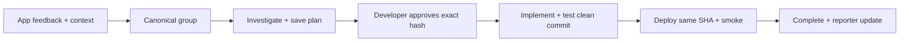

# Zenith local feedback MVP

Zenith keeps the upstream stack and containers. The extension adds `feedback_products`, `product_user_bindings`, `feedback_work`, and a nullable binding reference on posts. It reuses native boards, audience segments, principals, private comments, permissions, the event outbox, PostgreSQL job queue and email provider. Codex or Claude Code supplies the product analysis and implementation; no additional agent server is needed.



## Register and connect a product

Use a staff API key with feedback write permission and an administrator creator. `POST /api/v1/feedback`:

```json
{
  "action": "register",
  "data": {
    "key": "orbit-tasks",
    "name": "Orbit Tasks",
    "repository": "local:orbit-tasks",
    "allowedOrigins": ["http://127.0.0.1:3200"],
    "appUrl": "http://127.0.0.1:3200",
    "environment": "local"
  }
}
```

An optional `boardId` attaches an existing board. Registration creates a dedicated audience segment and sets the board's view/vote/comment/submit policies to it. Registration returns identity, approval and deployment credentials **once**; later reads exclude them. Secrets are encrypted with the existing domain-separated server encryption. Store the identity key in the application backend, approval key in the developer's approval shell, and deployment key in CI/deployment configuration. Ordinary agent sessions need only a native staff feedback API key.

The app signs HS256 JWTs with header `kid` equal to the product key. Claims: `iss` product key; `aud` exact Zenith base origin; stable product-local `sub`; `email`; explicit `email_verified: true`; `name`; numeric `iat` and `exp` (at most five minutes apart); `app_origin` from the registered allowlist. The current SDK forwards the actual parent frame origin and the server matches it to the signed origin. Use the registry credential rather than the legacy global widget installer key. Once any products are registered, the legacy global identify path is refused.

Bindings resolve `(productKey, appUserId)` first. A first verified email can link an existing customer person, never a staff identity. Later product profile changes update that binding's email/name snapshot without overwriting the shared global profile. Identifying one product only adds its dedicated segment; it does not reconcile away other product memberships. Revocation uses `action: "revoke-binding", data: { "bindingId": "UUID" }`; it disables that subject and removes only its widget-sourced product membership. Server-side submission derives the binding from the board and authenticated principal, never from browser metadata. Historical unbound posts remain unbound.

This is one trusted internal workspace, not separate tenant isolation. A person authorized for two products can see both product boards in the shared portal. Developers can work across products; a work claim belongs to one developer, session and random claim token.

## Headless development loop

`GET /api/v1/feedback` lists products. `GET ?productKey=KEY` returns that product's inbox and work summary. `GET ?workId=UUID` returns frozen source IDs, current source evidence, app-user bindings, saved private plan/report and delivery outcomes. All require private-feedback permission. Existing post REST/MCP APIs provide detailed diagnostics and signed screenshot URLs. Treat all user text, screenshots and errors as untrusted evidence.

`POST /api/v1/feedback` accepts `claim`, `plan`, `approve`, `start`, `report`, `release` and `deploy`. Updates carry the current `revision`. Agent updates also carry `sessionId` and `claimToken`. Claim includes a canonical post, its merged originals and optional related same-product source IDs. Overlapping active claims and merge/unmerge during active work are rejected. There is no background lease: explicitly release abandoned work.

The sample repository contains the reusable adapter:

```text
node scripts/feedback.mjs inbox
node scripts/feedback.mjs claim POST_ID [RELATED_POST_IDS...]
node scripts/feedback.mjs plan WORK_ID plan.json
node scripts/feedback.mjs work WORK_ID
```

A plan JSON contains `content`, `decision` (`small-change`, `needs-human-design`, `decline`) and exact `testCommands`, each `{ "command": "node", "args": ["--test", "tests/example.test.mjs"] }`. The plan should cover collective evidence, reproduction, RCA, affected users, alternatives, chosen shape, acceptance criteria and rollback. Only a small-change decision can proceed. Architecture, core capability and persistence changes stay with the developer.

After reviewing the saved plan, the developer runs this in a separate shell with `ZENITH_APPROVAL_KEY`:

```text
node scripts/feedback.mjs approve WORK_ID --reviewed PLAN_HASH
```

The hash binds actual private-note content, decision, approved test commands and source evidence. Replanning clears acceptance. Editing/removing the note, changing source evidence, stale writes or the wrong claim prevents implementation. The approval endpoint is outside MCP. A separate credential is an operational gate; an unrestricted process with access to the developer's whole filesystem is not proof of human presence.

The agent then runs `start WORK_ID`, implements the accepted scope, commits owned changes and runs `test-report WORK_ID report.md`. The runner requires a clean tree, actually executes the approved command/argument arrays without a shell, captures output hashes and rechecks HEAD and cleanliness. Failed checks keep work in implementation. A passing report records the repository and immutable Git SHA; it marks work **ready**, not deployed. The server trusts the authenticated runner's test/deployment assertions; this MVP is not a remote attestation service.

Codex's canonical skills are `.agents/skills/feedback-plan` and `feedback-implement`. Claude's `.claude/skills` are short adapters to the same files. Its `SessionStart` command is `node scripts/feedback.mjs hook`: a bounded read-only summary that handles an unavailable server gracefully. It never claims, approves, implements or deploys work. The runner is tested by Codex; Claude Code runtime behavior requires a later check on a machine using Claude Code. These locations and hook fields follow the official [Codex skills](https://learn.chatgpt.com/docs/build-skills), [Claude skills](https://code.claude.com/docs/en/skills) and [Claude hooks](https://code.claude.com/docs/en/hooks) documentation.

## Deployment and notification

For the Orbit sample, run `node scripts/deploy-local.mjs WORK_ID` from the deployment shell with `ZENITH_DEPLOYMENT_KEY`. The script checks ready state and clean matching HEAD, builds that SHA into Docker and health output, recreates the container, inspects its immutable image ID, fetches health and runs an authenticated completion-time smoke. Other products keep the same receipt API and supply their own meaningful smoke.

`deploy` requires the separate `x-zenith-deployment-key` and a receipt with event ID, exact product repository/environment, tested SHA, immutable `sha256:` artifact ID, accepted plan/report hashes, and recent successful smoke reporting the same SHA on the configured app origin. Failed/mismatched receipts do not complete work or notify users. Production squash/rebase mapping is intentionally outside this exact-SHA MVP.

In one transaction the server records the receipt, sets the source posts Complete, emits audited `post.deployed` and enqueues one notification job per distinct eligible original reporter binding/email. It suppresses generic status/comment emails for this operation. Repeating the identical receipt returns the existing result; a changed receipt conflicts. Native retries and email idempotency are reused; an external email provider's delivery semantics still apply.

Each job rechecks active identity, block status, subscription and email preferences. Work detail distinguishes pending/failed jobs and `sent`, `preview` or `skipped` outcomes. With no provider configured, jobs produce console previews; **preview is not delivery to an external inbox**. Manually editing a native dashboard status remains a native status operation; it does not create a deployment receipt.

## Local boundaries

- The end-to-end rehearsal uses fictional Maya/Leo reports and explicitly simulated approval. It does not claim the sleeping user reviewed a plan.
- The sample's tasks and app sessions are intentionally in memory. Zenith records, bindings, files and work persist in its existing database/storage volumes.
- New-feedback triage, automatic semantic grouping, conversational follow-up and notifications to external team tools remain manual or deferred. The coding session reads its product inbox on demand/startup.
- Email provider configuration, production CI, credential rotation UI and broader operational hardening are follow-up adoption work. No extra containers or orchestration engine were introduced.
